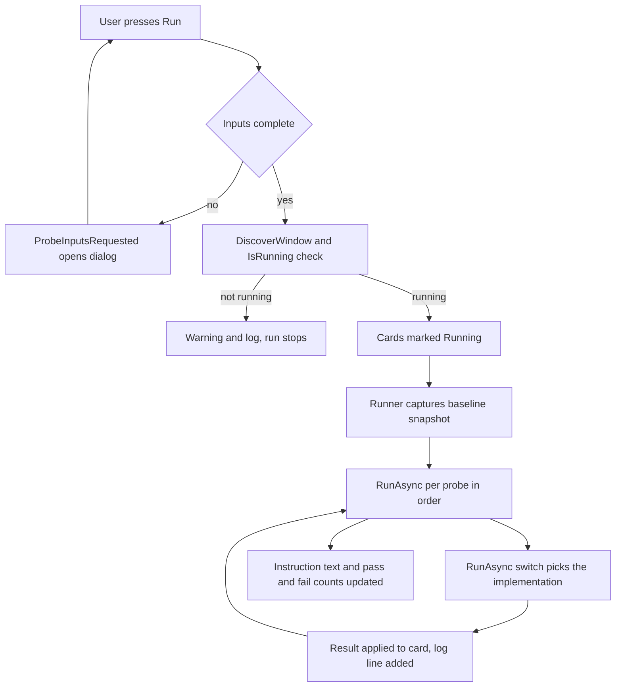

# How It Works at a Glance

Last Updated: 2026-11-11

Every step below names the class that performs it.

## 1. Page load

`View_VisualAutomation_MacroTester` resolves its view model with `App.GetService` and subscribes to
`ViewModel.ProbeInputsRequested`. `OnLoaded` calls `ViewModel.Initialize()`.

`Initialize()` does four things:

1. `IService_VisualAutomation_WindowDriver.DiscoverWindow()` - finds `VMRCVENT`, reads its title,
   rectangle, executable path, and element count.
2. `ApplyWindow` - sets `IsTargetReady` and the `TargetSummary` line.
3. Writes one `INFO` or `WARN` line into `LogEntries`.
4. `RefreshSnapshotSummary()` (only when the window is running) and `RefreshInputsSummary()`.

`RefreshSnapshotSummary()` calls `CaptureSnapshot()` and renders one line: order id, receiver id,
"n of m mapped variables readable", and whether a Save control was found.

## 2. Window discovery and field resolution

`DiscoverWindow()` takes the first `VMRCVENT` process with a non-zero main window handle. No retry loop.

`CaptureSnapshot()` re-runs discovery, enumerates every automation element under the window, then
`ResolveValueControls` pairs each of the 16 known labels with a value control on the same row. The match
rules are in the driver constants: within 8 px of the label's vertical centre, at least 18 px tall, at
least 40 px wide, starting at or right of the label's right edge.

## 3. Probe selection and the inputs gate

`Run selected probes` runs every card whose `IsSelected` is true, in catalogue order. `Run this probe`
on a card runs only that card. Both go through `RunProbesAsync`.

Before anything else, `RequiresInputs()` checks `Inputs.IsComplete`. When a value is blank the run is
blocked, a warning is logged, and `ProbeInputsRequested` fires so the view opens
`Dialog_VisualProbeInputs`. **Current behaviour:** this gate applies to every run, including runs that
contain only read-only probes.

## 4. Run

`Service_VisualAutomation_ProbeRunner.RunAllAsync` takes one baseline snapshot, then awaits `RunAsync`
per probe and calls the `onResult` callback as each result lands. `RunAsync` is a `switch` on `probe.Id`.
An unknown id returns a failing result saying `This probe has no implementation.`. Any exception is logged
and converted into a failing result; cancellation is rethrown.

## 5. Result reporting

- Card pill: `Enum_VisualProbeStatus` -> colour via `Converter_VisualMacroStatusToBrush`
  (grey not run, blue running, green pass, red fail).
- `Model_VisualProbeCard.DetailText` holds the verdict; the cards stay short.
- The details dialog (`Dialog_VisualProbeDetails`, opened by the icon button) lists every probe's
  verdict plus captured values, built by `ViewModel.BuildDetails()`.
- The activity log (`LogEntries`, capped at 500 lines) is written by `AddLog`, which also forwards to
  `IService_LoggingUtility`.

## 6. Threading and lifetime

The driver and runner are registered as singletons; the view model and view are transient. The runner
awaits with `ConfigureAwait(true)` so result callbacks land back on the UI thread. The write path awaits
`Task.Delay(320, token)` with `ConfigureAwait(false)`, and the token is the run's cancellation token.
