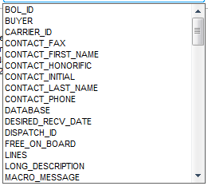
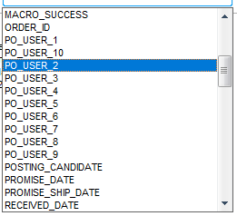
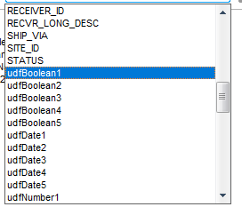
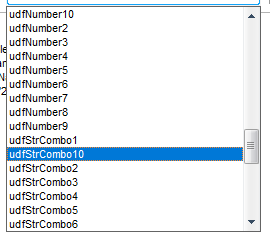
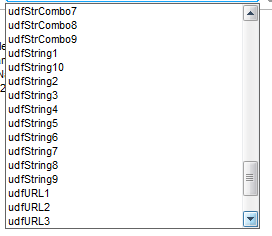
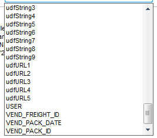
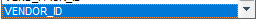

# Infor VISUAL Macro Dropdown, Annotated by Screenshot

Last Updated: 2026-11-11

`docs/development_images/` holds seven screenshots of the **Available Fields** dropdown in the Infor
VISUAL Purchase Receipt Entry macro editor (`VMRCVENT.EXE`). This page explains what every value in
each screenshot means, and records where that meaning was derived from.

The seven screenshots are successive scroll positions of **one** alphabetical list. Stitched together
they enumerate exactly **87** names, with no gaps and no duplicates. Screenshot 6 repeats the last ten
rows of screenshot 5, and that overlap is what proves the stitching is complete.

## Where each piece of evidence comes from

| Code | Source | What it establishes |
| ---- | ------ | ------------------- |
| `S1` | Live process memory of the running `VMRCVENT.EXE`, indexed as UTF-16 strings | The name really exists in the binary at runtime, and what the macro engine does with it |
| `S2` | Read-only queries against the live `MTMFG` SQL Server database | The meaning and the real backing table and column, or proof that no column exists |
| `S3` | Infor VISUAL API Toolkit assemblies and the Purchasing reference PDF, version 8.1.100.0 | Which receipt fields the toolkit annotates as **Required** |
| `S4` | `VMRCVENT.INI` on the VISUAL share | The line-grid column catalogue, used for the grid rather than the header |
| `F` | `Module_VisualAutomation/Helpers/Helper_VisualAutomation_FieldMap.cs` | The same binding held in code as `Bindings` and `_labels` |
| `UI` | `docs/development/InforVisual/Interaction_Guides/UI_Interaction_Guide.md` and a live UI Automation walk | The name is a real, visible control on the form |
| `IMG` | The screenshot itself | The name, its position in the list, and the selection highlight |

`S1` to `S4` are documented in full, with raw queries and hit counts, in
[InforVisual-Macro-Variable-Reference.md](InforVisual-Macro-Variable-Reference.md). That document is the
authority; this page reorganises the same findings around the screenshots.

Read-write class: **stored** means a saved column backs it, **derived** means the engine supplies it,
**scratch** means no persistence at all, and **output** means a macro writes it to report back.

---

## Screenshot 1: `MacroDropdown1.png`

Scroll position 1, from BOL_ID to MACRO_MESSAGE. The list starts here and the scrollbar thumb sits at the top, so this is the first page of the dropdown.

| # | Value | What it means | Backing column | RW | Derived from |
| - | ----- | ------------- | -------------- | -- | ------------ |
| 1 | `BOL_ID` | Bill of lading on the receipt | `RCV.BOL_ID` | stored | `S2` `IMG` |
| 2 | `BUYER` | Buyer code copied onto the PO | `PO.BUYER` | stored | `S2` `S3` `IMG` |
| 3 | `CARRIER_ID` | Carrier on the receipt | `RCV.CARRIER_ID` | stored | `S2` `IMG` |
| 4 | `CONTACT_FAX` | Vendor contact block on the PO | `PO.CONTACT_FAX` | stored | `S2` `IMG` |
| 5 | `CONTACT_FIRST_NAME` | Vendor contact block on the PO | `PO.CONTACT_FIRST_NAME` | stored | `S2` `IMG` |
| 6 | `CONTACT_HONORIFIC` | Vendor contact block on the PO | `PO.CONTACT_HONORIFIC` | stored | `S2` `IMG` |
| 7 | `CONTACT_INITIAL` | Vendor contact block on the PO | `PO.CONTACT_INITIAL` | stored | `S2` `IMG` |
| 8 | `CONTACT_LAST_NAME` | Vendor contact block on the PO | `PO.CONTACT_LAST_NAME` | stored | `S2` `IMG` |
| 9 | `CONTACT_PHONE` | Vendor contact block on the PO | `PO.CONTACT_PHONE` | stored | `S2` `IMG` |
| 10 | `DATABASE` | Connected VISUAL database name (MTMFG) | `none; supplied by the engine` | derived | `S1` `S2` `IMG` |
| 11 | `DESIRED_RECV_DATE` | The Receive on date, editable per line | `POL.DESIRED_RECV_DATE` | stored | `S2` `IMG` |
| 12 | `DISPATCH_ID` | Outside-service dispatch this receipt consumes | `SERVICE_RCVR_DISP.DISPATCH_ID` | stored | `S2` `IMG` |
| 13 | `FREE_ON_BOARD` | The box labelled FOB on screen; there is no FOB variable | `PO.FREE_ON_BOARD` | stored | `S2` `S3` `IMG` |
| 14 | `LINES` | Count of the receipt line collection; not an indexable array | `none; supplied by the engine` | derived | `S1` `S2` `IMG` |
| 15 | `LONG_DESCRIPTION` | Long description of the vendor's part | `VENDOR_PART.LONG_DESCRIPTION` | stored | `S2` `IMG` |
| 16 | `MACRO_MESSAGE` | Free text a macro returns to the caller | `none; written by a macro` | output | `S1` `IMG` |

---

## Screenshot 2: `MacroDropdown2.png`

Scroll position 2, from MACRO_SUCCESS to RECEIVED_DATE. PO_USER_2 is highlighted, so PO_USER_2 was the selected item when the screenshot was taken.

| # | Value | What it means | Backing column | RW | Derived from |
| - | ----- | ------------- | -------------- | -- | ------------ |
| 1 | `MACRO_SUCCESS` | Flag a macro sets to report success | `none; written by a macro` | output | `S1` `IMG` |
| 2 | `ORDER_ID` | The purchase order being received | `RCV.PURC_ORDER_ID = PO.ID` | stored | `S2` `S3` `IMG` |
| 3 | `PO_USER_1` | PO-level user-defined text 1 | `PO.USER_1, not PO_USER_1` | stored | `S2` `IMG` |
| 4 | `PO_USER_10` | PO-level user-defined text 10 | `PO.USER_10, not PO_USER_10` | stored | `S2` `IMG` |
| 5 | `PO_USER_2` | PO-level user-defined text 2 | `PO.USER_2, not PO_USER_2` | stored | `S2` `IMG` |
| 6 | `PO_USER_3` | PO-level user-defined text 3 | `PO.USER_3, not PO_USER_3` | stored | `S2` `IMG` |
| 7 | `PO_USER_4` | PO-level user-defined text 4 | `PO.USER_4, not PO_USER_4` | stored | `S2` `IMG` |
| 8 | `PO_USER_5` | PO-level user-defined text 5 | `PO.USER_5, not PO_USER_5` | stored | `S2` `IMG` |
| 9 | `PO_USER_6` | PO-level user-defined text 6 | `PO.USER_6, not PO_USER_6` | stored | `S2` `IMG` |
| 10 | `PO_USER_7` | PO-level user-defined text 7 | `PO.USER_7, not PO_USER_7` | stored | `S2` `IMG` |
| 11 | `PO_USER_8` | PO-level user-defined text 8 | `PO.USER_8, not PO_USER_8` | stored | `S2` `IMG` |
| 12 | `PO_USER_9` | PO-level user-defined text 9 | `PO.USER_9, not PO_USER_9` | stored | `S2` `IMG` |
| 13 | `POSTING_CANDIDATE` | Whether the PO may post to the GL | `PO.POSTING_CANDIDATE` | stored | `S2` `IMG` |
| 14 | `PROMISE_DATE` | Promised delivery date (screen: Promise Delivery Date) | `PO.PROMISE_DATE / POL.PROMISE_DATE` | stored | `S2` `IMG` |
| 15 | `PROMISE_SHIP_DATE` | Promised ship date (screen: Promise Ship Date) | `PO.PROMISE_SHIP_DATE` | stored | `S2` `IMG` |
| 16 | `RECEIVED_DATE` | Receipt transaction date (on screen: Act Recv Date) | `RCV.RECEIVED_DATE` | stored | `S2` `S3` `IMG` |

---

## Screenshot 3: `MacroDropdown3.png`

Scroll position 3, from RECEIVER_ID to udfNumber1. udfBoolean1 is highlighted, so it was the selected item at capture time.

| # | Value | What it means | Backing column | RW | Derived from |
| - | ----- | ------------- | -------------- | -- | ------------ |
| 1 | `RECEIVER_ID` | The receipt document number | `RCV.ID` | stored | `S2` `S3` `IMG` |
| 2 | `RECVR_LONG_DESC` | Long description or specs for the receipt line | `RL.DESCRIPTION` | stored | `S2` `IMG` |
| 3 | `SHIP_VIA` | Ship-via text copied onto the PO | `PO.SHIP_VIA` | stored | `S2` `S3` `IMG` |
| 4 | `SITE_ID` | Site the receipt is booked in | `RCV.SITE_ID` | stored | `S2` `S3` `IMG` |
| 5 | `STATUS` | PO release status | `PO.STATUS` | stored | `S2` `IMG` |
| 6 | `udfBoolean1` | Form-level user-defined boolean slot 1; no receipt column, safe scratch | `none on this screen` | scratch | `S2` `S1` `IMG` |
| 7 | `udfBoolean2` | Form-level user-defined boolean slot 2; no receipt column, safe scratch | `none on this screen` | scratch | `S2` `S1` `IMG` |
| 8 | `udfBoolean3` | Form-level user-defined boolean slot 3; no receipt column, safe scratch | `none on this screen` | scratch | `S2` `S1` `IMG` |
| 9 | `udfBoolean4` | Form-level user-defined boolean slot 4; no receipt column, safe scratch | `none on this screen` | scratch | `S2` `S1` `IMG` |
| 10 | `udfBoolean5` | Form-level user-defined boolean slot 5; no receipt column, safe scratch | `none on this screen` | scratch | `S2` `S1` `IMG` |
| 11 | `udfDate1` | Form-level user-defined date slot 1; no receipt column, safe scratch | `none on this screen` | scratch | `S2` `S1` `IMG` |
| 12 | `udfDate2` | Form-level user-defined date slot 2; no receipt column, safe scratch | `none on this screen` | scratch | `S2` `S1` `IMG` |
| 13 | `udfDate3` | Form-level user-defined date slot 3; no receipt column, safe scratch | `none on this screen` | scratch | `S2` `S1` `IMG` |
| 14 | `udfDate4` | Form-level user-defined date slot 4; no receipt column, safe scratch | `none on this screen` | scratch | `S2` `S1` `IMG` |
| 15 | `udfDate5` | Form-level user-defined date slot 5; no receipt column, safe scratch | `none on this screen` | scratch | `S2` `S1` `IMG` |
| 16 | `udfNumber1` | Form-level user-defined numeric slot 1; no receipt column, safe scratch | `none on this screen` | scratch | `S2` `S1` `IMG` |

---

## Screenshot 4: `MacroDropdown4.png`

Scroll position 4, from udfNumber10 to udfStrCombo6. udfStrCombo10 is highlighted, so it was the selected item at capture time.

| # | Value | What it means | Backing column | RW | Derived from |
| - | ----- | ------------- | -------------- | -- | ------------ |
| 1 | `udfNumber10` | Form-level user-defined numeric slot 10; no receipt column, safe scratch | `none on this screen` | scratch | `S2` `S1` `IMG` |
| 2 | `udfNumber2` | Form-level user-defined numeric slot 2; no receipt column, safe scratch | `none on this screen` | scratch | `S2` `S1` `IMG` |
| 3 | `udfNumber3` | Form-level user-defined numeric slot 3; no receipt column, safe scratch | `none on this screen` | scratch | `S2` `S1` `IMG` |
| 4 | `udfNumber4` | Form-level user-defined numeric slot 4; no receipt column, safe scratch | `none on this screen` | scratch | `S2` `S1` `IMG` |
| 5 | `udfNumber5` | Form-level user-defined numeric slot 5; no receipt column, safe scratch | `none on this screen` | scratch | `S2` `S1` `IMG` |
| 6 | `udfNumber6` | Form-level user-defined numeric slot 6; no receipt column, safe scratch | `none on this screen` | scratch | `S2` `S1` `IMG` |
| 7 | `udfNumber7` | Form-level user-defined numeric slot 7; no receipt column, safe scratch | `none on this screen` | scratch | `S2` `S1` `IMG` |
| 8 | `udfNumber8` | Form-level user-defined numeric slot 8; no receipt column, safe scratch | `none on this screen` | scratch | `S2` `S1` `IMG` |
| 9 | `udfNumber9` | Form-level user-defined numeric slot 9; no receipt column, safe scratch | `none on this screen` | scratch | `S2` `S1` `IMG` |
| 10 | `udfStrCombo1` | Form-level user-defined combo slot 1; no receipt column, safe scratch | `none on this screen` | scratch | `S2` `S1` `IMG` |
| 11 | `udfStrCombo10` | Form-level user-defined combo slot 10; no receipt column, safe scratch | `none on this screen` | scratch | `S2` `S1` `IMG` |
| 12 | `udfStrCombo2` | Form-level user-defined combo slot 2; no receipt column, safe scratch | `none on this screen` | scratch | `S2` `S1` `IMG` |
| 13 | `udfStrCombo3` | Form-level user-defined combo slot 3; no receipt column, safe scratch | `none on this screen` | scratch | `S2` `S1` `IMG` |
| 14 | `udfStrCombo4` | Form-level user-defined combo slot 4; no receipt column, safe scratch | `none on this screen` | scratch | `S2` `S1` `IMG` |
| 15 | `udfStrCombo5` | Form-level user-defined combo slot 5; no receipt column, safe scratch | `none on this screen` | scratch | `S2` `S1` `IMG` |
| 16 | `udfStrCombo6` | Form-level user-defined combo slot 6; no receipt column, safe scratch | `none on this screen` | scratch | `S2` `S1` `IMG` |

---

## Screenshot 5: `MacroDropdown5.png`

Scroll position 5, from udfStrCombo7 to udfURL3. Nothing is highlighted here; the list is simply scrolled further down.

| # | Value | What it means | Backing column | RW | Derived from |
| - | ----- | ------------- | -------------- | -- | ------------ |
| 1 | `udfStrCombo7` | Form-level user-defined combo slot 7; no receipt column, safe scratch | `none on this screen` | scratch | `S2` `S1` `IMG` |
| 2 | `udfStrCombo8` | Form-level user-defined combo slot 8; no receipt column, safe scratch | `none on this screen` | scratch | `S2` `S1` `IMG` |
| 3 | `udfStrCombo9` | Form-level user-defined combo slot 9; no receipt column, safe scratch | `none on this screen` | scratch | `S2` `S1` `IMG` |
| 4 | `udfString1` | Form-level user-defined text slot 1; no receipt column, safe scratch | `none on this screen` | scratch | `S2` `S1` `IMG` |
| 5 | `udfString10` | Form-level user-defined text slot 10; no receipt column, safe scratch | `none on this screen` | scratch | `S2` `S1` `IMG` |
| 6 | `udfString2` | Form-level user-defined text slot 2; no receipt column, safe scratch | `none on this screen` | scratch | `S2` `S1` `IMG` |
| 7 | `udfString3` | Form-level user-defined text slot 3; no receipt column, safe scratch | `none on this screen` | scratch | `S2` `S1` `IMG` |
| 8 | `udfString4` | Form-level user-defined text slot 4; no receipt column, safe scratch | `none on this screen` | scratch | `S2` `S1` `IMG` |
| 9 | `udfString5` | Form-level user-defined text slot 5; no receipt column, safe scratch | `none on this screen` | scratch | `S2` `S1` `IMG` |
| 10 | `udfString6` | Form-level user-defined text slot 6; no receipt column, safe scratch | `none on this screen` | scratch | `S2` `S1` `IMG` |
| 11 | `udfString7` | Form-level user-defined text slot 7; no receipt column, safe scratch | `none on this screen` | scratch | `S2` `S1` `IMG` |
| 12 | `udfString8` | Form-level user-defined text slot 8; no receipt column, safe scratch | `none on this screen` | scratch | `S2` `S1` `IMG` |
| 13 | `udfString9` | Form-level user-defined text slot 9; no receipt column, safe scratch | `none on this screen` | scratch | `S2` `S1` `IMG` |
| 14 | `udfURL1` | Form-level user-defined URL slot 1; no receipt column, safe scratch | `none on this screen` | scratch | `S2` `S1` `IMG` |
| 15 | `udfURL2` | Form-level user-defined URL slot 2; no receipt column, safe scratch | `none on this screen` | scratch | `S2` `S1` `IMG` |
| 16 | `udfURL3` | Form-level user-defined URL slot 3; no receipt column, safe scratch | `none on this screen` | scratch | `S2` `S1` `IMG` |

---

## Screenshot 6: `MacroDropdown6.png`

Scroll position 6, from udfString3 to VEND_PACK_ID. The first ten rows repeat the tail of position 5, and that ten-row overlap is what makes the stitched list provably gapless.

| # | Value | What it means | Backing column | RW | Derived from |
| - | ----- | ------------- | -------------- | -- | ------------ |
| 1 | `udfString3` | Form-level user-defined text slot 3; no receipt column, safe scratch | `none on this screen` | scratch | `S2` `S1` `IMG` |
| 2 | `udfString4` | Form-level user-defined text slot 4; no receipt column, safe scratch | `none on this screen` | scratch | `S2` `S1` `IMG` |
| 3 | `udfString5` | Form-level user-defined text slot 5; no receipt column, safe scratch | `none on this screen` | scratch | `S2` `S1` `IMG` |
| 4 | `udfString6` | Form-level user-defined text slot 6; no receipt column, safe scratch | `none on this screen` | scratch | `S2` `S1` `IMG` |
| 5 | `udfString7` | Form-level user-defined text slot 7; no receipt column, safe scratch | `none on this screen` | scratch | `S2` `S1` `IMG` |
| 6 | `udfString8` | Form-level user-defined text slot 8; no receipt column, safe scratch | `none on this screen` | scratch | `S2` `S1` `IMG` |
| 7 | `udfString9` | Form-level user-defined text slot 9; no receipt column, safe scratch | `none on this screen` | scratch | `S2` `S1` `IMG` |
| 8 | `udfURL1` | Form-level user-defined URL slot 1; no receipt column, safe scratch | `none on this screen` | scratch | `S2` `S1` `IMG` |
| 9 | `udfURL2` | Form-level user-defined URL slot 2; no receipt column, safe scratch | `none on this screen` | scratch | `S2` `S1` `IMG` |
| 10 | `udfURL3` | Form-level user-defined URL slot 3; no receipt column, safe scratch | `none on this screen` | scratch | `S2` `S1` `IMG` |
| 11 | `udfURL4` | Form-level user-defined URL slot 4; no receipt column, safe scratch | `none on this screen` | scratch | `S2` `S1` `IMG` |
| 12 | `udfURL5` | Form-level user-defined URL slot 5; no receipt column, safe scratch | `none on this screen` | scratch | `S2` `S1` `IMG` |
| 13 | `USER` | VISUAL login of the operator | `none; supplied by the engine` | derived | `S1` `S2` `IMG` |
| 14 | `VEND_FREIGHT_ID` | Vendor freight bill on the receipt | `RCV.VEND_FREIGHT_ID` | stored | `S2` `IMG` |
| 15 | `VEND_PACK_DATE` | Vendor packlist date on the receipt | `RCV.VEND_PACK_DATE` | stored | `S2` `IMG` |
| 16 | `VEND_PACK_ID` | Vendor packlist on the receipt | `RCV.VEND_PACK_ID` | stored | `S2` `IMG` |

---

## Screenshot 7: `MacroDropdown7.png`

Scroll position 7, the final entry. VEND_PACK_ID is partly visible above VENDOR_ID and VENDOR_ID is highlighted, so this is the bottom of the list.

| # | Value | What it means | Backing column | RW | Derived from |
| - | ----- | ------------- | -------------- | -- | ------------ |
| 1 | `VENDOR_ID` | Vendor on the purchase order | `PO.VENDOR_ID` | stored | `S2` `S1` `IMG` |

---

## What the seven screenshots settle

| Finding | Evidence |
| ------- | -------- |
| The dropdown holds exactly 87 entries | Stitching screenshots 1 to 7, allowing for the ten-row overlap in screenshot 6, gives 87 unique names with no gaps |
| Only 42 of the 87 are real variables | 35 header columns, 2 line-scoped variables and 5 engine variables; the other 45 are `udf*` scratch slots (`S2`) |
| The list is sorted as text, not as numbers | Screenshot 2 shows `PO_USER_1`, `PO_USER_10`, `PO_USER_2`; screenshot 4 shows `udfNumber10` before `udfNumber2` (`IMG`) |
| The list runs alphabetically from `BOL_ID` to `VENDOR_ID` | Screenshot 1 opens at `BOL_ID`, screenshot 7 closes at `VENDOR_ID` (`IMG`) |
| `PO_USER_n` is not a column name | Screenshot 2 lists `PO_USER_n`, but the column is `PURCHASE_ORDER.USER_n` (`S2`) |
| `FREE_ON_BOARD` is the FOB box | Screenshot 1 lists `FREE_ON_BOARD` and no `FOB` at all, while the on-screen label is FOB (`S2` `UI`) |
| `DESIRED_RECV_DATE` reads as Receive on | The variable name and the screen label disagree entirely (`S2` `UI`) |

## Known discrepancy with the code

`Helper_VisualAutomation_FieldMap._macroVariables` holds the same 87 names but does not keep the
editor's order. Its XML comment says "in the editor's alphabetical order", yet the four families that
reach index 10 are listed numerically instead of as text.

| Family | Screenshot order | Code order |
| ------ | ---------------- | ---------- |
| `PO_USER_n` | 1, 10, 2, 3, ... 9 | 1, 2, 3, ... 10 |
| `udfNumber` | 1, 10, 2, 3, ... 9 | 1, 2, 3, ... 10 |
| `udfStrCombo` | 1, 10, 2, 3, ... 9 | 1, 2, 3, ... 10 |
| `udfString` | 1, 10, 2, 3, ... 9 | 1, 2, 3, ... 10 |

The set of names is identical, so nothing functional depends on the order: `Bindings` is a dictionary
keyed by name. Only the display order of `MacroVariables` differs.

## See Also

- [InforVisual-Macro-Variable-Reference.md](InforVisual-Macro-Variable-Reference.md) - the full evidence trail
- [InforVisual-Macro-Automation.md](InforVisual-Macro-Automation.md) - how the app drives these fields without a macro
- [UI_Interaction_Guide.md](InforVisual/Interaction_Guides/UI_Interaction_Guide.md) - the live control inventory
